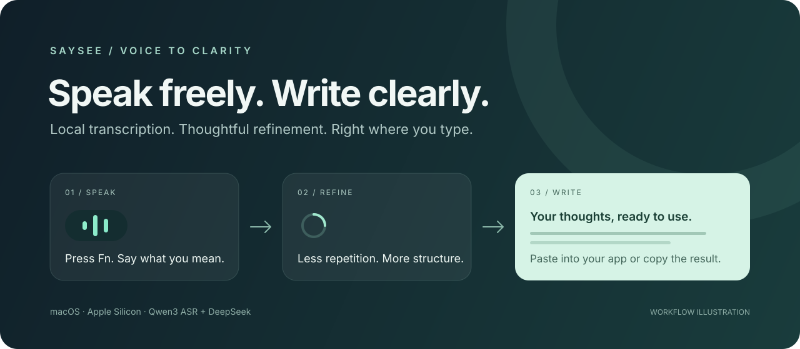

<div align="center">

# Saysee

### Speak freely. Write clearly.

Turn spoken thoughts into concise, well-structured text — right where you type.

[](https://github.com/Torfin-Li/saysee/actions/workflows/ci.yml)
[](#getting-started)
[](#how-it-works)
[](LICENSE)

[Get started](#getting-started) · [How it works](#how-it-works) · [Privacy](#your-voice-your-data) · [Contribute](CONTRIBUTING.md)

<br>



</div>

> **Source preview · v0.1.0** — Build and test locally on Apple Silicon. A signed, notarized DMG is not available yet.

## From a thought to a finished sentence

Saysee is a native macOS menu bar app for voice input. Press **Fn** to record, speak naturally, then press **Fn** again to finish. Local speech recognition transcribes your voice; DeepSeek corrects likely recognition errors, removes repetition, and organizes your thoughts into readable plain text.

When Saysee can identify an editable target, it attempts to paste the result into your app. Otherwise, it shows a result card and copies the text to your clipboard.

| Speak naturally | Keep it clear | Stay in your flow |
| :--- | :--- | :--- |
| Chinese and English transcription with local Qwen3 ASR. | Concise wording, clearer structure, and numbered points when useful. | Fn to start and finish; click the recording capsule to finish, or Esc to cancel. |
| A quiet indicator stays still; detected sound brings it to life. | Plain text you can use in messages, notes, and documents. | Automatic paste when possible, with a result card and clipboard fallback. |

## How it works

```text
Microphone → Qwen3 ASR on your Mac → DeepSeek text refinement → Paste / Copy
             Local audio processing   Cloud text processing
```

- **Native foundation.** Swift, SwiftUI, MLX, and Metal; no Python runtime or local web server needed by the built app.
- **Local transcription.** Qwen3 ASR 1.7B, 6-bit weights. Complete 30-second chunks are transcribed during longer recordings; the final chunk is processed when you stop.
- **Focused refinement.** DeepSeek receives text only, with thinking disabled. The model name is configurable.
- **Small, deliberate UI.** A compact recording capsule, speech activity feedback, and a clear processing indicator.

Recordings can last up to five minutes. Short recordings are transcribed after you stop; this is not word-by-word live transcription.

## Getting started

### 1. Build the app

You will need:

- An **Apple Silicon Mac**; macOS 14 or later is the deployment target.
- **Xcode 26.6 / Swift 6.3** and Apple's Metal Toolchain.
- **Python 3** and **uv** for model preparation only.
- Your own **DeepSeek API key** for text refinement.

The currently validated environment is Apple M3 running macOS 26.5.2. Other supported hardware and OS combinations have not been fully tested.

```sh
git clone https://github.com/Torfin-Li/saysee.git
cd saysee

xcodebuild -downloadComponent MetalToolchain
./scripts/bootstrap.sh
./scripts/build-app.sh
./scripts/run-app.sh
```

The first setup downloads approximately **2 GB** of pinned model weights. The resulting app is at `dist/Saysee.app`. Local builds use ad-hoc signing for development testing.

### 2. Set up once

1. Open **Speech & Refinement**, enter your DeepSeek API key and model, and test the connection. The test sends a fixed sample sentence.
2. Check **Microphone**, **Accessibility**, and **Input Monitoring** in **Devices & Permissions**. Restart the app if macOS requests it.
3. Set the system Fn / Globe key action to **Do Nothing** to avoid triggering dictation or changing input sources.
4. Focus an editable field, press **Fn**, speak, and press **Fn** again.

The current app interface is in Chinese; the English names above describe the corresponding settings.

### 3. Make it part of your workflow

| Action | Control |
| :--- | :--- |
| Start or finish recording | **Fn** or **⌘⇧Space** |
| Finish with the mouse | Click the recording capsule |
| Cancel | **Esc** |
| Quit the app | Menu bar → **Quit Saysee**, the settings quit button, or **⌘Q** while settings is focused |

Closing the settings window hides that window. **Quitting Saysee stops the app.**

See the [development guide](docs/development.md) for build details, configuration, and troubleshooting.

## Your voice, your data

**Speech recognition runs locally. Text refinement uses the cloud.** The full transcript is sent to DeepSeek through your own account, so this is not a fully offline workflow.

| Data | Where it goes |
| :--- | :--- |
| Microphone audio | Processed in memory on your Mac; not saved as a recording or sent to the LLM. |
| Transcript | Sent to DeepSeek for refinement. Provider pricing and data policies apply. |
| API key | Stored in macOS Keychain. No service account files or cloud authentication environment variables are read. |
| Diagnostic logs | Local stage timings and necessary status metadata; no transcript, refined text, or API key. |
| Output | Kept in the system clipboard. Using **Copy Key** also places the API key on the clipboard. |

Read the [privacy and data flow notes](docs/privacy.md) or [report a security issue privately](SECURITY.md).

## Before you rely on it

<details>
<summary><strong>Preview limitations</strong></summary>

- Some third-party keyboards handle Fn in firmware and never expose it to macOS. Use **⌘⇧Space** instead.
- Automatic paste depends on macOS Accessibility. Custom editors and web controls may fall back to the result card; there are no app-specific compatibility rules.
- “Inserted” currently means a paste shortcut was sent, not that the target app confirmed insertion. The result remains in your clipboard.
- Initial model loading, GPU compilation, and cloud response times affect latency. The 30-second chunk boundary can split words.
- Canceling invalidates a result, but an active GPU chunk may finish before the inference channel becomes available again.
- Sound activity detection is not speaker recognition; sustained loud noise can animate the indicator.
- The LLM can miscorrect words, omit details, or infer relationships incorrectly. Review important text before using it.

</details>

## Build with us

Contributions and reproducible bug reports are welcome. Start with [CONTRIBUTING.md](CONTRIBUTING.md).

```sh
swift test -j 2
python3 -m unittest discover -s scripts/validation -p 'test_*.py'
```

| Explore | Purpose |
| :--- | :--- |
| [`Sources/SayseeApp`](Sources/SayseeApp) | Native app, recording, inference, overlay, settings, and text delivery |
| [`Sources/SayseeCore`](Sources/SayseeCore) | Session state, audio processing, shortcut policies, and LLM requests |
| [`Tests`](Tests) | Swift unit tests |
| [`scripts`](scripts) | Model setup, builds, and publication audits |
| [`docs`](docs) | Architecture, development, privacy, and release notes |

**Further reading:** [Architecture](docs/architecture.md) · [Development](docs/development.md) · [Release checklist](docs/releasing.md) · [Release review](docs/release-review.md)

Supporting documentation is currently in Chinese. Model caches, recordings, local experiments, internal notes, and build artifacts are excluded from the public source.

## Credits & license

Built on [Qwen3 ASR](https://github.com/QwenLM/Qwen3-ASR), [MLX Audio Swift](https://github.com/Blaizzy/mlx-audio-swift), and [MLX Swift](https://github.com/ml-explore/mlx-swift), using the [Qwen3-ASR-1.7B-6bit weights](https://huggingface.co/mlx-community/Qwen3-ASR-1.7B-6bit).

Saysee's source code is licensed under [MIT](LICENSE). Models and dependencies retain their own licenses; see [third-party notices](THIRD_PARTY_NOTICES.md).
